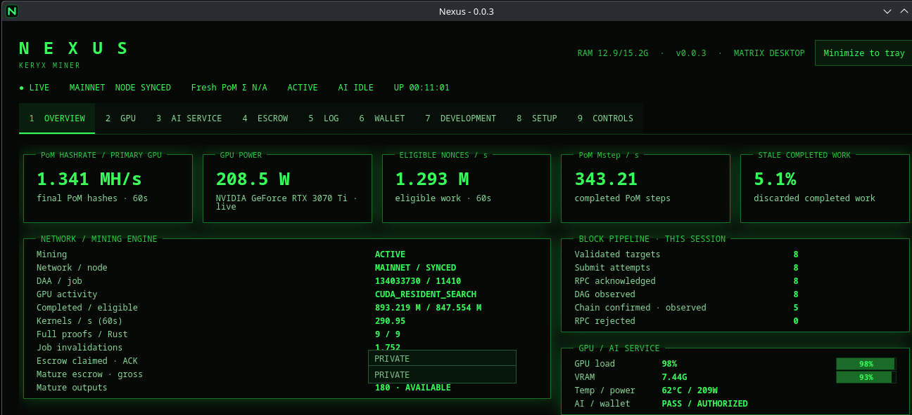
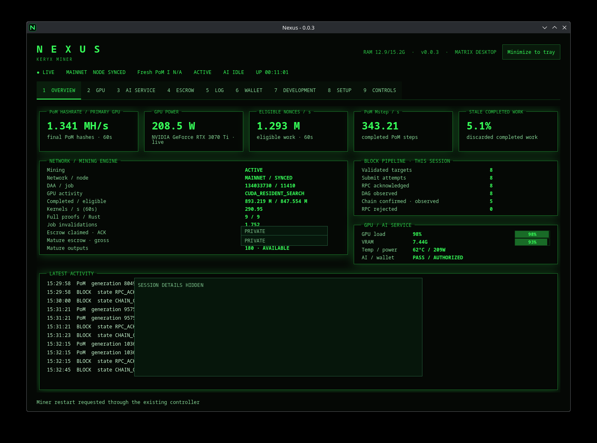
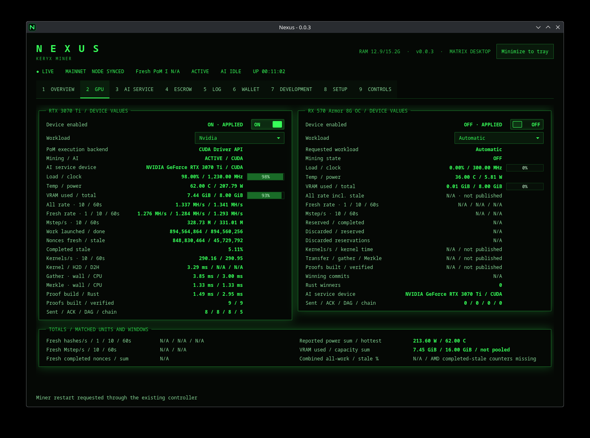
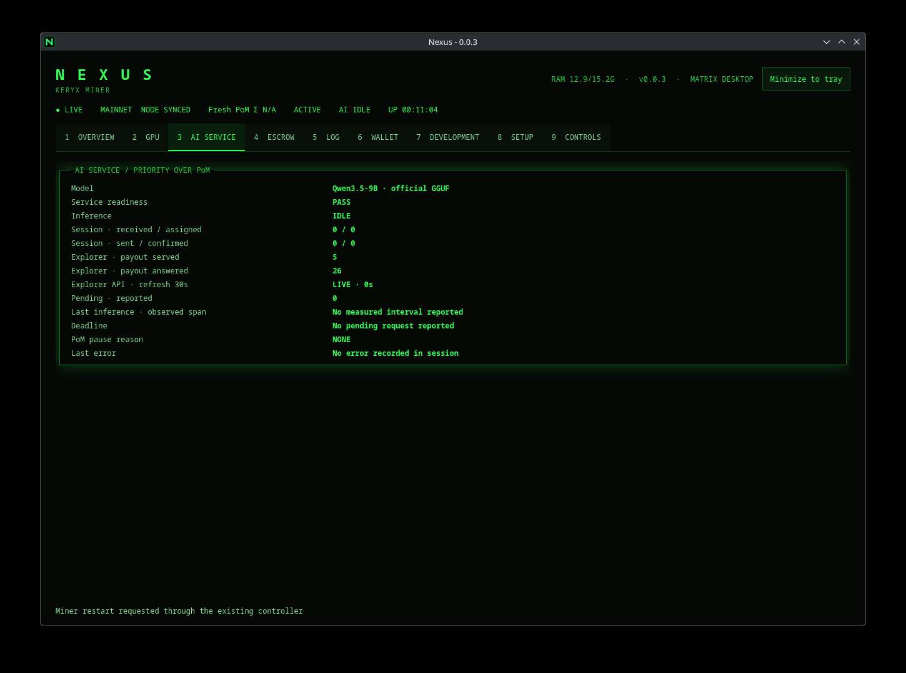
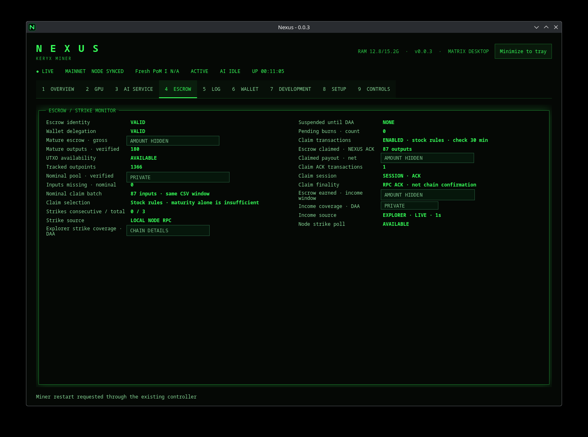
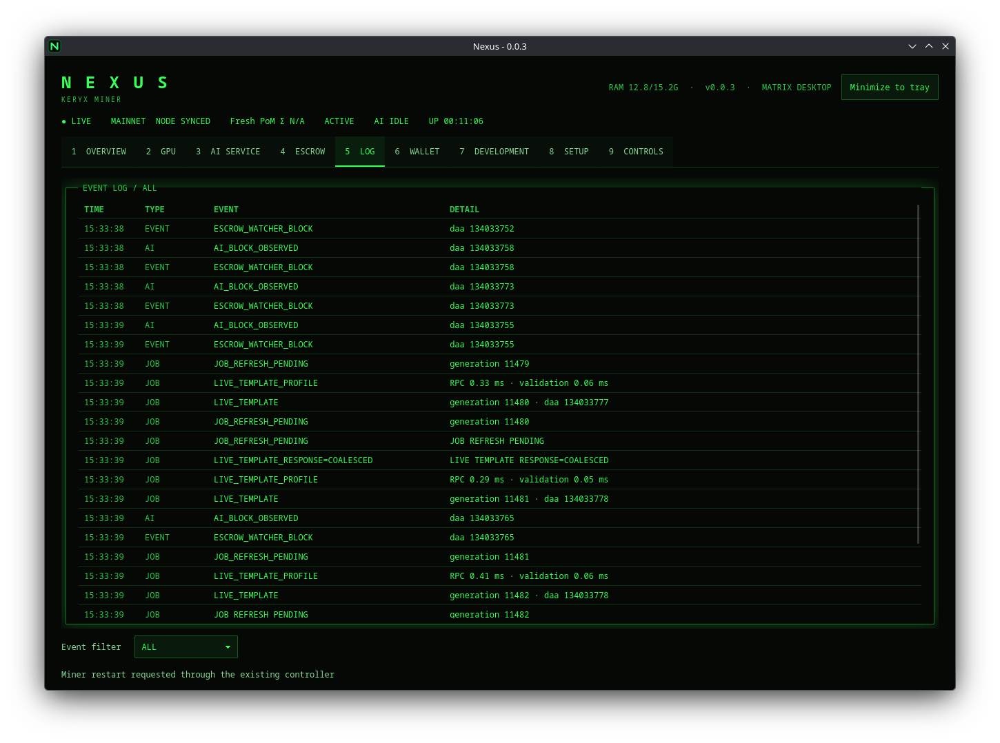
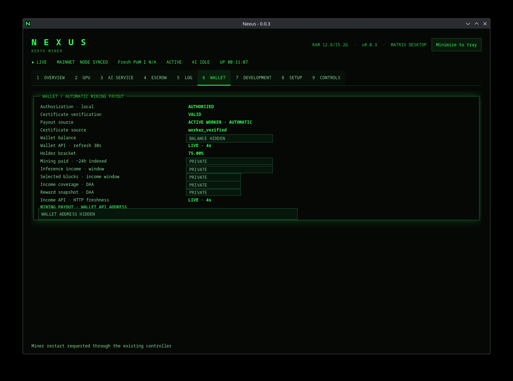
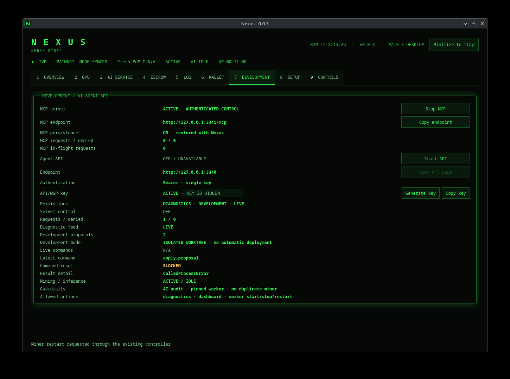
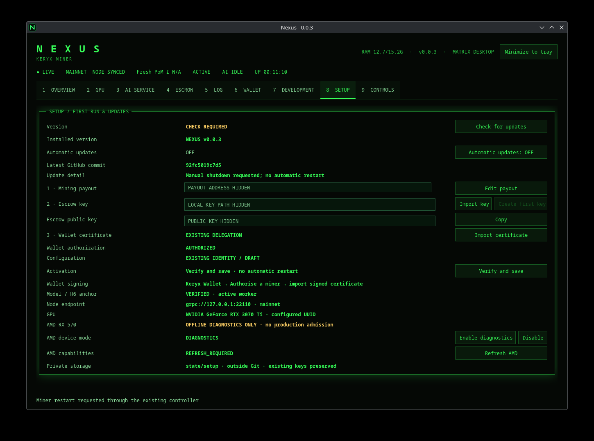
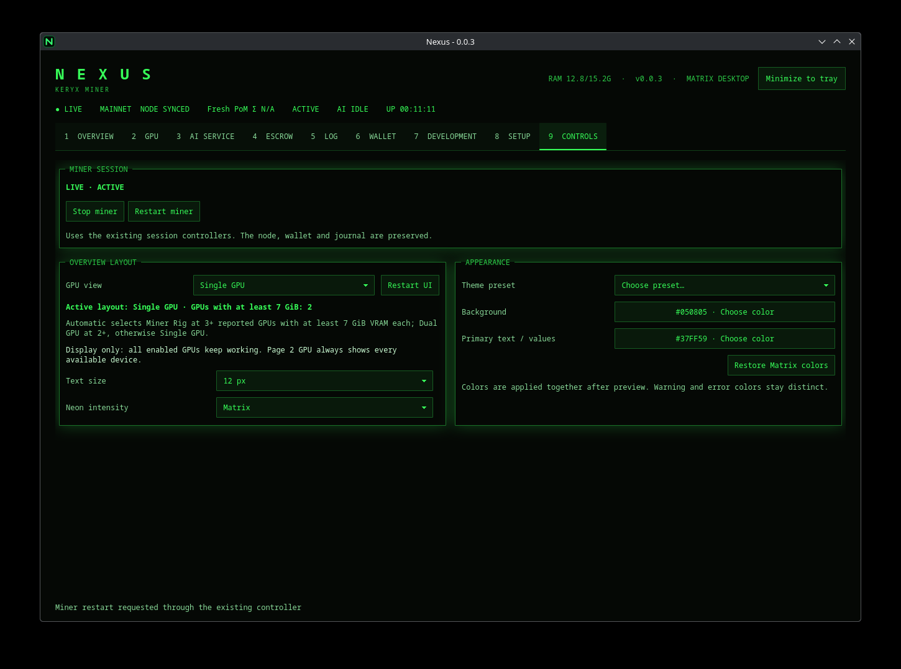

# Nexus Keryx Miner

**An experimental, source-first Proof-of-Model miner with a native GPU worker, independent proof verification and a local desktop control surface.**

Nexus brings Keryx mining, AI service status, wallet authorization, escrow monitoring and GPU telemetry into a single Linux desktop application. The mining engine is primarily C++20 with CUDA support; Rust components handle independent verification and signing-related work, while Python provides local control and presentation services. The desktop is built with Tauri.

> **Project status — 0.0.4 beta.** Linux x86-64 remains the development baseline. A **native Windows x64 CUDA CLI preview** is developed and tested on GitHub Actions; GPU execution on Windows is not yet validated. Native H15 tier-0 CUDA paths have local GPU/mock validation; live H15 chain acceptance remains unvalidated. Models, Merkle trees, keys and private installation state are external inputs.



*The screenshots below are from a local development installation. Wallet identifiers, key paths, key identifiers, balances and identifying session details have been obscured. Values visible in the screenshots are illustrative observations from that installation, not reproducible benchmarks or claims of general hardware support.*

See the [0.0.4 release notes](docs/release-0.0.4.md) for the upstream protocol refresh, ABI9 runtime, recovery fixes and complete-session SUBMIT/ERROR logs.

## What Nexus does

- **Native Proof-of-Model execution:** current-job handling, nonce scheduling, device-side PoM work, witness construction, target checks and explicit submission boundaries.
- **Independent verification:** a Rust oracle can verify canonical proof material independently of the optimized GPU execution path.
- **GPU monitoring and selection:** separate device visibility, workload selection, admission checks, telemetry and guarded handoff; a device shown in the UI is not necessarily admitted for mining.
- **AI service integration:** tracks model readiness, assignments, responses and deadlines; AI work takes priority over new mining batches when authorized and available.
- **Wallet and escrow workflows:** protected wallet configuration, delegation/certificate validation, UTXO and claim visibility, and distinct states for RPC acknowledgment and on-chain confirmation.
- **Local controls and diagnostics:** desktop actions, a loopback API and an optional authenticated MCP service, with source proposals isolated from the running miner.

## Downloads and Windows

The [Native CLI workflow](https://github.com/tonythewizard/nexus-keryx-miner/actions/workflows/windows.yml)
builds Windows and Linux executables, the Rust verifier and matching inference
runtime, runs CPU/API tests and packages ZIP/tar.gz archives with runtime dependencies, licenses and SHA-256 checksums.
Successful workflow runs provide the preview under **Artifacts**. Tagged downloads
appear on the [Releases page](https://github.com/tonythewizard/nexus-keryx-miner/releases).
Only a completed packaging job produces a downloadable binary archive.

| Distribution | Scope |
| --- | --- |
| Linux x86-64 | CLI preview built on Ubuntu 24.04; existing desktop available from source |
| Windows x64 preview | Native CLI, NVIDIA SM 8.6, explicit local profile; no WSL requirement |
| Windows desktop, Windows AMD/Vulkan, macOS | Not included in the preview |

See **[Native Windows setup and builds](docs/windows.md)** for prerequisites,
package verification, private configuration and the exact validation limits.
The CLI archives remain experimental. Native H15 tier-0 CUDA paths have local
GPU/mock validation; live H15 chain acceptance and Windows GPU execution remain
unvalidated. Compilation and CPU tests do not certify GPU execution of the
exact downloadable archives.

## Desktop walkthrough

Nexus has nine pages. Together they expose the state of a local installation without requiring every subsystem to be managed from a terminal.

### 1 · Overview



The landing page summarizes the running session. It presents the primary GPU's PoM hash rate, power consumption, eligible nonce throughput, PoM steps per second and stale completed-work ratio. A second panel follows the chain job, mining state, work invalidations, proof verification and escrow availability. Block processing is displayed as separate stages—validated target, submission attempt, RPC acknowledgment, DAG observation and observed chain selection—rather than combining them into a single success counter. A recent-activity feed connects events to the running session. Rate windows, missing values and source freshness are kept separate.

### 2 · GPU



Per-device cards report enabled state, selected workload, execution backend, device utilization, graphics clock, temperature, power and VRAM. Where available, the page also displays all-work and fresh-work rates, completed and discarded nonces, kernel timings, gather/Merkle time, Rust proof construction and submission counters. The primary CUDA lane and a secondary device are presented independently; combined statistics are withheld when source counters are incomplete or incompatible.

A GPU toggle expresses a requested change, not an automatic compatibility guarantee. A secondary AMD card can appear for inventory or offline diagnostics without being admitted to production PoM work. The interface does not imply universal Vulkan support or unlimited multi-GPU scheduling.

### 3 · AI Service



Shows which model is configured, whether the inference adapter reports readiness, the current service state and the lifecycle of AI requests: received, assigned, sent and confirmed where observable. Deadline, pending-request, last-observed-inference, error and PoM pause-reason fields help distinguish genuine service activity from an idle but prepared model. The worker prioritizes authorized AI requests while preserving mining state and resuming eligible mining work afterward. The model in the screenshot belongs to the local installation and is not bundled with this repository.

### 4 · Escrow



The escrow view tracks delegation validity, mature outputs, available UTXOs, the nominal claim pool, claim eligibility, missing inputs, strikes, and income/claim status. It distinguishes available rewards, assembled claims and RPC acknowledgment from confirmed settlement. Rules such as maturity, ownership, duplicate spending and the current claim window remain part of the underlying workflow; a visible claim count alone is not proof of finality.

### 5 · Log



A consolidated event stream for node jobs, PoM work, AI requests, escrow and submission transitions. Filters select all events or focus on AI, submission, job and error categories. Timestamps and event classes make it easier to diagnose refreshes, state transitions and failures without conflating unrelated workflows. The displayed sample contains operational event categories and generic chain/job diagnostics; sensitive wallet and session identifiers are not shown.

### 6 · Wallet



Displays local wallet authorization, certificate validation, payout source and read-only status gathered from configured services. When available, balance, indexed mining income, inference income, selected blocks and freshness indicators are reported separately. The wallet page is a status and authorization view, not a wallet seed manager. Its displayed payout address and amounts are intentionally redacted in the public gallery; private signing material is not distributed with the source.

### 7 · Development



Surfaces the optional authenticated MCP service and local Agent API: whether they are enabled, endpoint availability, request counters, authentication status, permission scopes and latest command outcomes. Supported workflows include diagnostics, controlled development proposals and explicitly gated live commands. Source proposals are applied in isolated Git worktrees, not deployed automatically to the running worker. API and MCP keys are sensitive operational credentials; only redacted key identifiers appear in the gallery.

### 8 · Setup



Groups first-run requirements and local configuration: installed source version, manual update checks, payout address, escrow key selection, public-key display, delegation certificate, wallet authorization, node connection and GPU identification. It also exposes AMD diagnostic availability and a manual capability refresh. Configuration is held outside the source tree; live wallet/key values shown during setup must never be committed. Automatic binary updates remain disabled for this public source distribution: the legacy updater expects a private repository and a different artifact workflow.

### 9 · Controls



Provides explicit miner stop/restart requests through the existing controllers and desktop-only preferences for GPU presentation, font size, neon intensity and Matrix color selection. The GPU layout setting changes presentation; it does not quietly enable or disable mining devices. Sensitive actions require confirmation and must preserve the configured wallet, node and journal boundaries.

## Processing model

```text
Current node template
        │
        ▼
Freshness and job lease checks
        │
        ▼
Authorized GPU work / nonce scheduling
        │
        ▼
PoM result and witness construction
        │
        ▼
Independent Rust verification + target check
        │
        ▼
Payout / delegation authorization
        │
        ▼
Block assembly → RPC submission → chain observation
```

These are separate trust boundaries. An acknowledged RPC request is not a chain confirmation, and a proof that passes a local test is not evidence that a live block will be accepted. AI requests can temporarily preempt the relevant mining lane; only authorized and ready models should be selected. Escrow claims follow their own validation and reconciliation path.

## Technology and repository layout

| Component | Technology / location | Responsibility |
| --- | --- | --- |
| Native miner | C++20 · `src/model/`, `consensus/` | Job scheduling, PoM execution, witness and submission logic |
| CUDA backend | CUDA Driver API · `consensus/cuda_walk.cpp` and CUDA sources | GPU proof work with device-specific admission |
| Experimental Vulkan | Vulkan · `src/gpu/`, `experiments/vulkan_jit/` | Guarded non-CUDA execution and restricted source-to-SPIR-V research |
| Proof oracle | Rust · `oracle-rust/` | Independent validation against pinned protocol sources |
| Response/signing bridge | Rust · `ai-response-bridge/` | Authorized response serialization, trace and signing-related logic |
| Local services | Python · `scripts/` | Wallet/status reads, GPU control policy, API/MCP, telemetry and UI presenter |
| Desktop | Tauri 2 · `nexus-ui-desktop/` | Native window, tray and typed control surface |
| Protocol and upstream inputs | `proto/`, `vendor/`, `THIRD_PARTY.md` | Wire formats, imported code and license notices |
| Publication checks | `.github/workflows/`, `tools/security_gate.py` | Source privacy scans, history checks and offline policy tests |

## Build and validation

This project is intended for developers compiling against their own compatible toolchains and authorized runtime inputs. A useful **offline CPU-only** starting point, from a fresh checkout with the prerequisites in [devkit.md](devkit.md), is:

```sh
mkdir -p .local/tmp
export TMPDIR="$PWD/.local/tmp" TMP="$PWD/.local/tmp" TEMP="$PWD/.local/tmp"
export PYTHONDONTWRITEBYTECODE=1
python3 tools/prepare_assets.py
cmake -S . -B build/cpu -G Ninja \
  -DCMAKE_BUILD_TYPE=Release \
  -DNEXUS_ENABLE_GRPC=OFF \
  -DNEXUS_ENABLE_CUDA=OFF \
  -DNEXUS_ENABLE_VULKAN_JIT=OFF
cmake --build build/cpu --parallel 1
ctest --test-dir build/cpu --output-on-failure
```

This configuration performs CPU-only builds and deterministic tests; it does **not** start a miner or establish CUDA, Vulkan, inference, escrow, mainnet or live hardware acceptance. See [devkit.md](devkit.md) for the dependency list, platform boundaries, Rust oracle build, GPU compilation and external runtime requirements.

## Scope and known limitations

- **Linux x86-64** is the development baseline. Native Windows CLI porting and CI are available as an experimental preview; Windows GPU execution and macOS support are not established.
- Current native CUDA kernels target **SM 8.6** and require an explicit runtime GPU UUID and compatible runtime dependencies.
- The **Vulkan backend is experimental**; visibility of AMD or Intel options in controls does not demonstrate tested support for those GPUs. Device admission and proof parity must be established on the actual target hardware.
- The source baseline does not establish complete H15 verifiable inference support, arbitrary multi-GPU scheduling or a portable installation flow.
- Preview packages are unsigned; this repository does not provide an automatic binary-update channel. The legacy updater expects a private repository; leave automatic updates disabled here.
- Live operation requires external model weights, a compatible inference adapter, Merkle data, independent proof verifier, a synced node, and local wallet/delegation configuration. **Never commit those runtime materials.**
- Screenshots document one local runtime session, not reproducible performance measurements or universal feature validation.

## Security and contributing

Secrets, wallet keys, delegation certificates, machine identifiers, model files, service data and logs belong outside Git. This repository runs publication checks for disallowed files, private identifiers, credential-like values and reachable Git history. The checks reduce exposure risk but cannot replace manual review.

Please read [SECURITY.md](SECURITY.md) before reporting vulnerabilities or publishing changes. Report suspected vulnerabilities privately rather than through a public issue or PR; private disclosure must be enabled by the repository owner. Developer documentation is in [devkit.md](devkit.md), and provenance/license details are in [THIRD_PARTY.md](THIRD_PARTY.md).

## License

Nexus's original contributions are licensed under **GNU GPL-3.0-only**; see [LICENSE](LICENSE). Imported source retains the applicable third-party notices described in [THIRD_PARTY.md](THIRD_PARTY.md). External weights, GPU toolkits and runtime libraries are not relicensed here.
